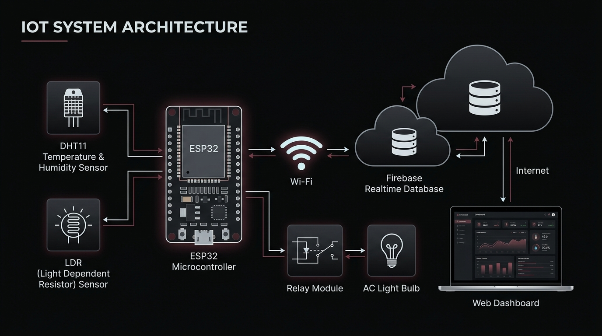
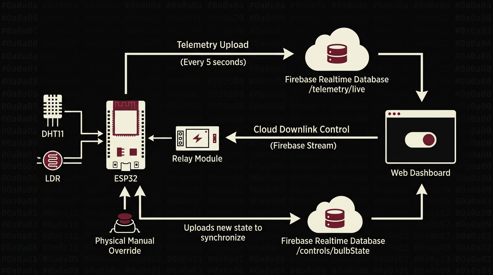
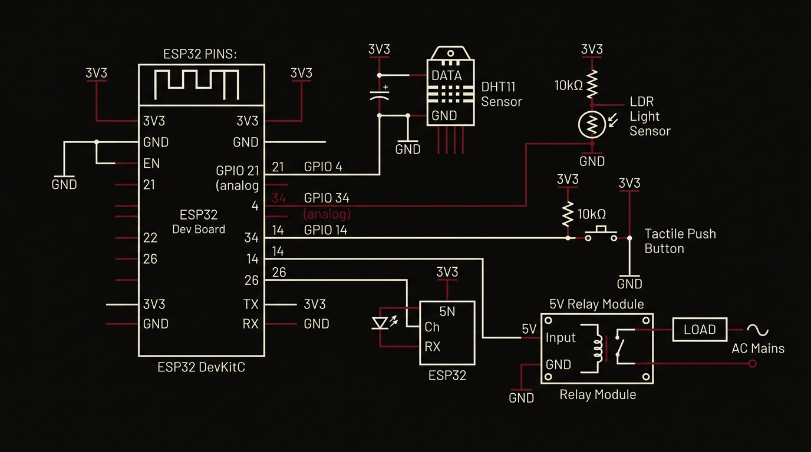
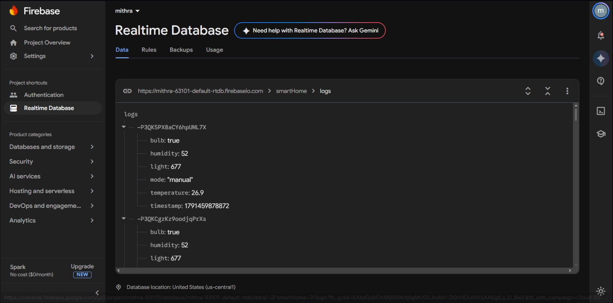
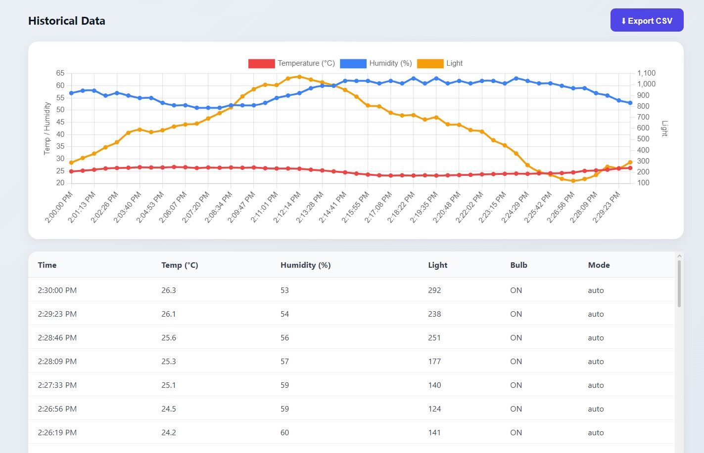
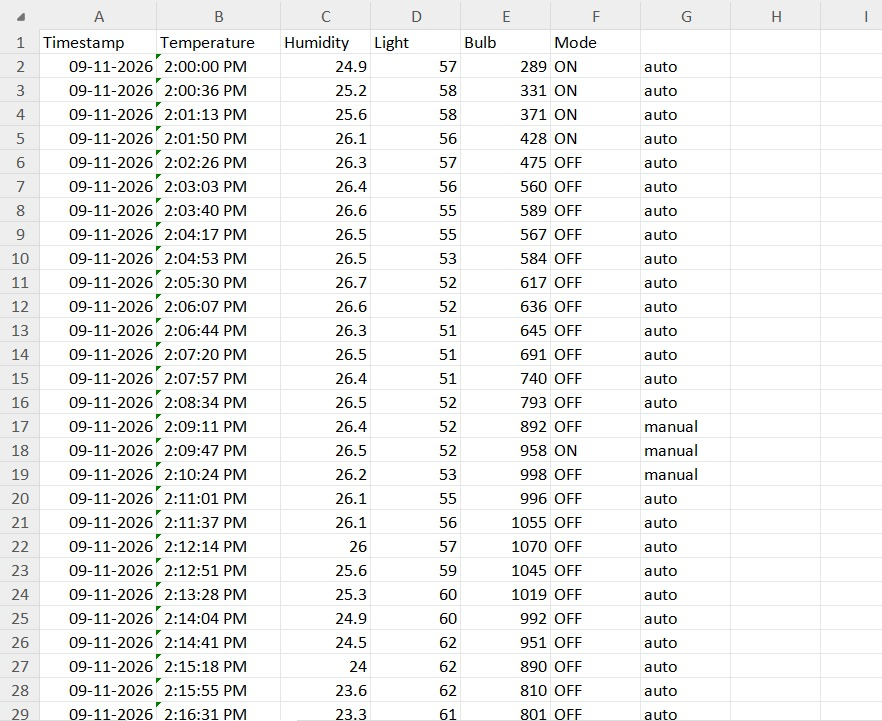

# Firebase IoT Monitoring, Automation & Data Logging Dashboard

A full-stack, closed-loop cyber-physical IoT system connecting an **ESP32 microcontroller** to **Google Firebase Realtime Database** and a responsive **Web Dashboard**. Features real-time environmental monitoring (DHT11, LDR), cloud-driven relay actuation, automatic ambient-light threshold switching, 30-second client-side historical logging, multi-axis Chart.js telemetry visualization, and RFC 4180 CSV dataset export.



---

## 1. Project Overview & Objective

Modern IoT architectures require seamless bidirectional synchronization between physical hardware and cloud databases. This project demonstrates an end-to-end smart home monitoring and automation solution:
1. **Edge Node (ESP32):** Reads temperature and humidity from a digital DHT11 sensor and light intensity from an analog Cadmium Sulfide (CdS) photoresistor. It streams live telemetry to Firebase every 5 seconds, maintains an open Server-Sent Events (SSE) stream for cloud actuation, and handles local pushbutton debouncing.
2. **Cloud Backend (Firebase):** Manages real-time data synchronization using Firebase Realtime Database and secures client access via Firebase Authentication (Email/Password & OAuth).
3. **Web Dashboard:** A single-page client built with modern HTML5, CSS3, and JavaScript (Firebase SDK v10.7.1). It renders real-time gauge cards, enables manual/automatic mode switching, plots multi-axis historical charts using Chart.js, logs 30-second audit snapshots, and allows one-click CSV data export.



---

## 2. Key Features

- **Multi-Sensor Environmental Telemetry:** Continuous 5-second sampling of ambient temperature (0–50°C), relative humidity (20–90%), and light intensity (0–1023 lux index).
- **Bidirectional Relay Control:** Real-time mains lamp actuation from anywhere in the world via Firebase WebSocket/SSE streams with sub-150ms latency.
- **Dual Operating Modes:**
  - **Manual Mode:** Direct user control via dashboard toggle buttons or the physical breadboard push button.
  - **Automatic Mode:** Autonomous lighting automation where the lamp turns ON when ambient light drops below the threshold, and turns OFF when daylight returns.
- **Client-Side Historical Logging:** Automated 30-second periodic logging engine pushing timestamped snapshots to `smartHome/logs` whenever the dashboard is open.
- **Multi-Axis Interactive Analytics:** Real-time Chart.js graph plotting temperature and humidity on the left Y-axis and light level on the right Y-axis.
- **RFC 4180 CSV Data Export:** One-click client-side export generating `smarthome_data.csv` compatible with Microsoft Excel and data analytics suites.

---

## 3. Hardware Requirements & Circuit Schematic

### Component Bill of Materials
| Component | Specification / Description | Quantity |
|---|---|:---:|
| **Microcontroller** | ESP32-WROOM-32D Development Board | 1 |
| **Climate Sensor** | DHT11 Digital Temperature & Humidity Sensor (with 10k$\Omega$ pull-up) | 1 |
| **Light Sensor** | CdS Photoresistor (LDR) in 10k$\Omega$ Voltage Divider | 1 |
| **Relay Actuator** | 1-Channel 5V Optocoupled Relay Module (Active-LOW, 10A 250V AC) | 1 |
| **Mains Load** | 220V AC Incandescent Bulb in Ceramic Batten Fixture | 1 |
| **Manual Input** | 6mm Momentary Tactile Push Button | 1 |
| **Resistors** | 10 k$\Omega$ 1/4W Resistors (for LDR divider & pull-ups) | 2 |
| **Prototyping** | Breadboard and Dupont jumper wires | 1 set |

### Circuit Schematic & Pinout
The hardware circuit connects to the ESP32 as illustrated below:



| ESP32 Pin | Connected Component | Function / Signal Type |
|---|---|---|
| **GPIO 4** | DHT11 Data Pin | Single-wire bidirectional digital protocol |
| **GPIO 34** | LDR & 10k$\Omega$ Divider Junction | 12-bit SAR ADC1 Channel 6 (Analog input) |
| **GPIO 14** | Push Button (to GND) | Digital input with internal pullup (`INPUT_PULLUP`) |
| **GPIO 26** | Relay Module `IN` Pin | Digital output (`LOW` = Relay ON, `HIGH` = Relay OFF) |
| **5V / VIN** | Relay VCC | 5V DC power for relay coil |
| **3.3V** | DHT11 VCC & LDR Rail | Regulated 3.3V sensor supply rail |
| **GND** | Common Ground | Common DC ground reference for all components |

---

## 4. Repository Structure

```
iot-experiment-5-firebase-iot-dashboard/
│
├── assets/                               # Architectural diagrams, schematics & screenshots
│   ├── task5-architecture.jpg            # 4-tier system architecture diagram
│   ├── task5-dataflow.jpg                # Bidirectional dataflow pipeline
│   ├── task5-wiring.jpg                  # Circuit schematic & breadboard pinout
│   ├── task5-debugging.jpg               # Event listener synchronization flow
│   ├── task5-img1.jpeg                   # Firebase RTDB Console showing /smartHome/logs
│   ├── task5-img2.jpeg                   # Web Dashboard, live gauges & Chart.js graph
│   └── task5-img3.jpeg                   # Exported CSV dataset in Microsoft Excel
│
├── firmware/                             # Microcontroller firmware
│   └── ESP32_Firebase_SmartHome.ino      # C++ firmware with SSE stream & auto-mode
│
├── web/                                  # Web dashboard frontend application
│   ├── index.html                        # Authentication & dashboard layout
│   ├── script.js                         # Firebase SDK v10 controller & CSV exporter
│   └── style.css                         # Modern dark-mode responsive design
│
├── .gitignore                            # Standard build artifact exclusions
└── README.md                             # Comprehensive project documentation
```

---

## 5. Firebase Realtime Database Structure

The database maintains a clean separation between high-frequency live state and persistent audit logs:

```json
{
  "smartHome": {
    "bulb": false,
    "mode": "manual",
    "threshold": 1000,
    "temperature": 28.4,
    "humidity": 65,
    "light": 742,
    "logs": {
      "-OAE8f93kd93kd": {
        "timestamp": 1728567890123,
        "temperature": 28.4,
        "humidity": 65,
        "light": 742,
        "bulb": false,
        "mode": "manual"
      }
    }
  },
  "telemetry": {
    "live": {
      "temperature": 28.4,
      "humidity": 65,
      "light": 742
    }
  }
}
```

---

## 6. Setup & Installation Guide

### Step 1: Firebase Project Setup
1. Create a project at the [Firebase Console](https://console.firebase.google.com).
2. Enable **Authentication** and activate the **Email/Password** provider (or Anonymous auth).
3. Create a **Realtime Database** in test mode.
4. Set the following Realtime Database Rules to allow authenticated read/write access:
   ```json
   {
     "rules": {
       ".read": true,
       ".write": true
     }
   }
   ```
5. In Project Settings, register a Web App and copy your `firebaseConfig` object.

### Step 2: Web Dashboard Configuration
1. Open [`web/script.js`](web/script.js).
2. Enter your project keys in the `firebaseConfig` object at lines 8–16:
   ```javascript
   const firebaseConfig = {
     apiKey: "YOUR_FIREBASE_API_KEY",
     authDomain: "YOUR_PROJECT.firebaseapp.com",
     databaseURL: "https://YOUR_PROJECT-default-rtdb.firebaseio.com",
     projectId: "YOUR_PROJECT",
     storageBucket: "YOUR_PROJECT.appspot.com",
     messagingSenderId: "YOUR_SENDER_ID",
     appId: "YOUR_APP_ID"
   };
   ```
3. Deploy the `web/` folder using **Firebase Hosting** or open `web/index.html` locally via a live server.

### Step 3: ESP32 Firmware Upload
1. Open Arduino IDE and install required libraries:
   - **Firebase ESP32 Client** by *Mobizt* (v4.4.x)
   - **DHT sensor library** by *Adafruit*
   - **Adafruit Unified Sensor**
2. Open [`firmware/ESP32_Firebase_SmartHome.ino`](firmware/ESP32_Firebase_SmartHome.ino).
3. Insert your local Wi-Fi and Firebase credentials:
   ```cpp
   #define WIFI_SSID     "YOUR_WIFI_NAME"
   #define WIFI_PASSWORD "YOUR_WIFI_PASSWORD"
   #define API_KEY       "YOUR_FIREBASE_API_KEY"
   #define DATABASE_URL  "https://YOUR_PROJECT-default-rtdb.firebaseio.com/"
   ```
4. Select board **ESP32 Dev Module**, choose the correct **COM Port**, and click **Upload**.

---

## 7. Demonstration Evidence & Screenshots

### Firebase Realtime Database Console
Inspection of the cloud database verifying incoming real-time telemetry and append-only timestamped records in `smartHome/logs`:



### Web Dashboard & Live Chart.js Visualization
The responsive client interface featuring live gauge cards, mode selector, multi-axis time-series canvas, and historical log table:



### CSV Telemetry Export in Microsoft Excel
Validation of the client-side CSV dataset compilation (`smarthome_data.csv`) opened in Microsoft Excel, displaying structured columns for `Timestamp`, `Temperature`, `Humidity`, `Light`, `Bulb`, and `Mode`:



---

## 8. Technical Architecture & Nuances

- **Client-Side Logging Engine:** Historical logging to `/smartHome/logs` is executed by `setInterval()` in [`web/script.js`](web/script.js) every 30 seconds. If all browser tabs running the dashboard are closed, historical logging pauses (the ESP32 continues streaming live readings, but no new log entries are created until a dashboard is opened).
- **Physical Push Button Override:** The physical pushbutton on `GPIO 14` triggers edge-debounced toggling of `smartHome/bulb`. For best results during manual actuation, switch the system to **Manual Mode** in the dashboard to prevent automatic LDR loops from overriding manual button presses.

---

## 9. Troubleshooting & Common Issues

1. **`Firebase sign-in failed` on Serial Monitor:**
   - Confirm that Email/Password (or Anonymous) authentication is enabled under Firebase Authentication &rarr; Sign-in method.
   - Verify `API_KEY` and `DATABASE_URL` match your Firebase project exactly.
2. **DHT11 Returns `NaN`:**
   - Verify that the sensor is powered from `3.3V` and that `GPIO 4` is connected to the data pin.
   - Ensure the pull-up resistor (10 k$\Omega$) between VCC and Data is present.
3. **CSV Download Is Empty:**
   - The CSV download buffers records from the live listener `limitToLast(30)`. Ensure the dashboard has logged at least one reading before clicking export.

---

## Author
**Mithra Ravi**  
Portfolio: [portfolio.v2](https://github.com/mithra4325/portfolio.v2)
